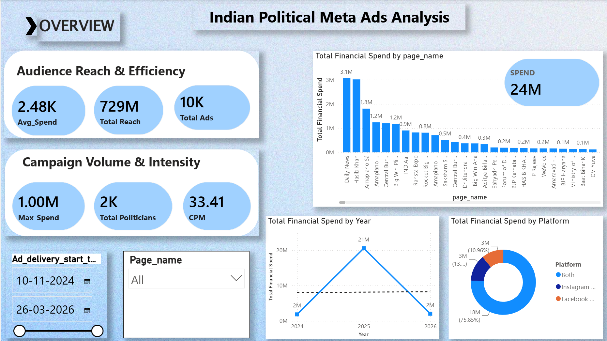
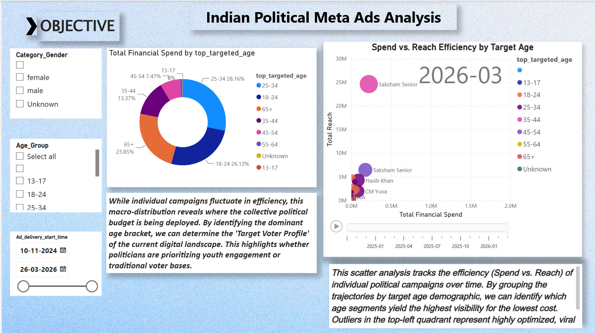

# Indian Political Meta Ads Analysis

> A Power BI dashboard companion for exploring political advertising activity on Meta platforms in India.

This repository brings together the project dataset, exploratory notebooks, and a dashboard preview. The dashboard documentation below is intentionally limited to the two supplied pages and the visuals visible in their screenshots.

## Dashboard previews

### Overview

The **Overview** page provides a high-level view of campaign scale, spend, and reach.

- KPI cards show **Avg Spend (2.48K)**, **Total Reach (729M)**, **Total Ads (10K)**, **Max Spend (1.00M)**, **Total Politicians (2K)**, **CPM (33.41)**, and total **Spend (24M)**.
- A page-level bar chart ranks **Total Financial Spend by page_name**.
- A line chart tracks **Total Financial Spend by Year**.
- A donut chart breaks down **Total Financial Spend by Platform**.
- Date and page-name slicers support focused exploration. The captured view spans **10 November 2024 to 26 March 2026**.

### Objective: audience targeting and efficiency

The **Objective** page focuses on targeting patterns and the relationship between spend and reach.

- Gender, age-group, and delivery-date slicers provide audience and period filtering.
- A donut chart shows **Total Financial Spend by top_targeted_age**.
- A scatter chart, **Spend vs. Reach Efficiency by Target Age**, compares total financial spend with total reach and includes a time playback control.
- The page’s accompanying notes frame the view as a way to compare age-segment targeting and identify campaigns that achieve high reach relative to spend.

## Repository contents

- `data/` — the Meta political ads dataset and data dictionary.
- `notebooks/` — cleaning, EDA, objectives, and conclusion notebooks.
- `images/` — existing notebook-output images.
- `assets/` — dashboard screenshots used in this README.
- `docs/` — methodology and limitations placeholders.

## Power BI source availability

The dashboard screenshots are included here as a portfolio preview. The Power BI source file (`.pbix`) is **not included in this repository**, and this project does not claim that it has been uploaded. To make the report reproducible, add the original Power BI file separately when it is available and appropriate to share.

## License

This project is distributed under the [MIT License](LICENSE).
